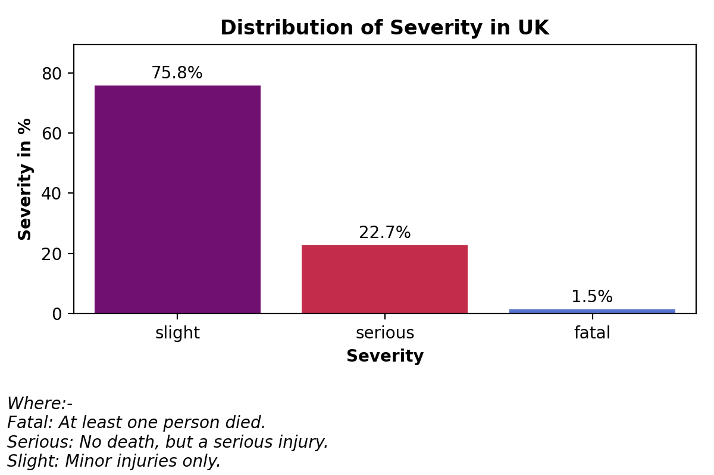
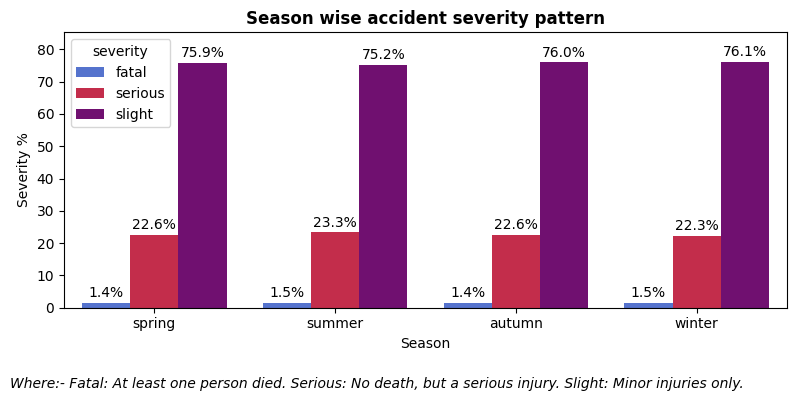
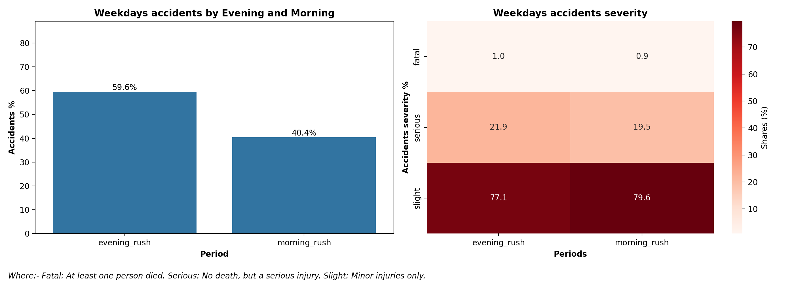

# Gravite — UK Road Accident Severity Prediction

[](https://uk-road-accident-severity-prediction-kvagwdjbzfetxjurws6bcz.streamlit.app)
[](https://www.python.org/)
[](https://pandas.pydata.org/)
[](https://scikit-learn.org/)
[](https://seaborn.pydata.org/)
[](https://plotly.com/)

> **Live link → [uk-road-accident-severity-prediction-kvagwdjbzfetxjurws6bcz.streamlit.app](https://uk-road-accident-severity-prediction-kvagwdjbzfetxjurws6bcz.streamlit.app)**

**Gravite** (from the French *gravité*, meaning severity) is a `HistGradientBoostingClassifier` machine learning model that predicts whether a road accident is likely to result in KSI (Killed or Seriously Injured) using only pre-crash conditions. The model is served through an interactive Streamlit dashboard.

---

## 📌 Overview

| | |
|---|---|
| **Problem** | Road accidents are classified as *slight*, *serious*, or *fatal*. Which pre-crash conditions make a KSI outcome more likely? |
| **Approach** | Clean + merge three open-data tables → explore → train a **`HistGradientBoostingClassifier`** for **binary KSI classification** |
| **App** | Streamlit dashboard with an interactive 30-feature accident form, live probability + decision at threshold **0.50**, full EDA gallery, and model architecture details |
| **Design rule** | **No imputation & native categorical splits** — missing values stay `NaN` and categorical features use native histogram binning (`categorical_features='from_dtype'`). |

---

## 📊 Dataset

Publicly available **UK road-accident open data (STATS19)** across three tables:

| Table | Role |
|---|---|
| **Collisions** | One row per accident — location, road, light, weather, conditions, hour, and severity |
| **Casualties** | Per-casualty details, aggregated (e.g., vulnerable / e-scooter casualties, average IMD) |
| **Vehicles** | Per-vehicle details, aggregated (e.g., max vehicle age, max engine CC, driver age) |

After cleaning and merging:

- **513,801 accidents** × **30 modeling features** (8 numerical, 11 binary flags, 11 categorical)
- Severity labels: `1 → fatal`, `2 → serious`, `3 → slight`
- Missing codes (`-1`, `9`, …) converted to **`NaN` — never imputed**
- **Target:** binary **KSI** = fatal + serious (24.2%) vs slight (75.8%) — a ~76 / 24 class imbalance

---

## 🔍 Exploratory Data Analysis

Key findings from the EDA notebook:

- **Class imbalance:** 75.8% slight · 22.7% serious · 1.5% fatal — accuracy alone is misleading (an "always slight" model already scores 75.8%)
- **Urban vs rural:** rural accidents are far more dangerous — fatal share is **~3.5× higher** on rural roads (2.8% vs 0.8%)
- **Season:** barely matters — slight-accident share stays ~75–76% across all four seasons
- **Time of day:** accident volume peaks around **evening rush hours** (59.6%) compared to morning rush hours (40.4%)
- **Pedestrians:** accidents involving a pedestrian are much more likely to be serious/fatal (KSI share 33.6% vs 22.8% without)
- **Deprivation (IMD):** KSI share rises slightly with area deprivation — from 23.0% (least deprived) to 25.4% (most deprived)
- **Spatial hotspots:** a **1 km-grid KSI-rate map** (interactive Plotly map inside the app) highlights where serious accidents concentrate

<details>
<summary><b>📊 Chart gallery (click to expand)</b></summary>

| Severity distribution | Urban vs rural |
|---|---|
|  |  |

### Season pattern


### Rush hours


| Pedestrian involvement | IMD deprivation |
|---|---|
|  |  |

</details>

---

## 🤖 Model — HistGradientBoostingClassifier

**Why `HistGradientBoostingClassifier`?** It bins continuous features into histograms for fast training across 5.13 lakh records, handles 11 categorical features natively (`from_dtype`) without high-dimensional One-Hot Encoding, and learns optimal split directions for `NaN` values directly without imputation.

**Why balanced?** With a 76/24 split, unweighted models drift toward predicting "slight". `class_weight='balanced'` forces attention onto severe crashes — in road safety, **catching KSI cases (Recall) matters more than raw accuracy**.

| Setting | Value |
|---|---|
| Estimator | `HistGradientBoostingClassifier(categorical_features='from_dtype', class_weight='balanced', max_leaf_nodes=255, min_samples_leaf=100, learning_rate=0.05, l2_regularization=1.0, early_stopping=True)` |
| Validation split | 411,040 train / 102,761 test (stratified 80/20) |
| Production training | 100% dataset (513,801 records; early stopped at **167 iterations**) |
| **Decision threshold** | **0.50** (saved inside the inference bundle) |

**Validation Performance at Threshold 0.50 (Positive Class = KSI):**

| Metric | Score |
|---|---|
| Precision | **0.37** |
| Recall | **0.66** — catches ~66 of every 100 KSI-prone accidents |
| F1-Score | **0.48** |
| Macro F1 | **0.61** |
| Majority-class baseline (accuracy) | 0.758 |

> **Feature design:** only pre-accident causal inputs go into `X` (30 features total):
> - **8 Numeric:** `speed_limit`, `number_of_vehicles`, `min_driver_age`, `max_driver_age`, `max_vehicle_age`, `max_engine_cc`, `male_driver_share`, `avg_casualty_imd`
> - **11 Binary:** `has_cycle`, `has_motorcycle`, `has_goods_vehicle`, `has_bus`, `has_vulnerable_vehicle`, `has_overtaking`, `has_turning`, `has_vulnerable_casualty`, `has_escooter_casualty`, `has_pedestrian_movement`, `trunk_road_flag`
> - **11 Categorical:** `urban_or_rural_area`, `road_type`, `light_conditions`, `weather_conditions`, `road_surface_conditions`, `special_conditions_at_site`, `carriageway_hazards`, `junction_detail`, `junction_control`, `day_of_week`, `hour`

### Model Bundle & Training Script

- **`gravite/train.py`:** Object-oriented (`GraviteProductionTrainer`) script that loads the dataset, enforces the exact 30-feature schema, trains on 100% of records, and exports a compressed bundle.
- **Inference Bundle:** Stores the trained pipeline, feature order, exact `CategoricalDtype` schemas, and decision threshold together:

```python
{
    "model": pipeline,
    "features": feature_cols,
    "cat_dtypes": cat_dtypes,
    "threshold": 0.50,
}
