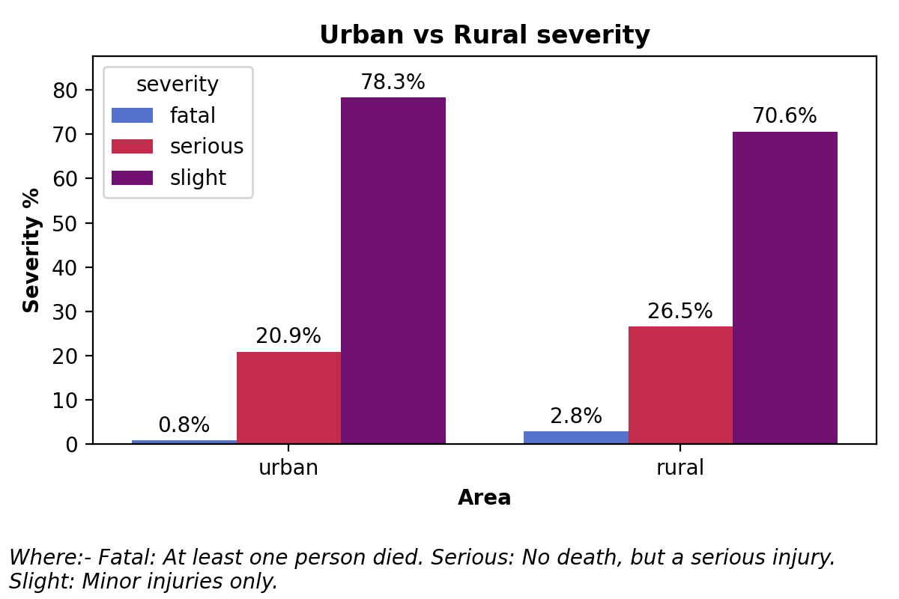
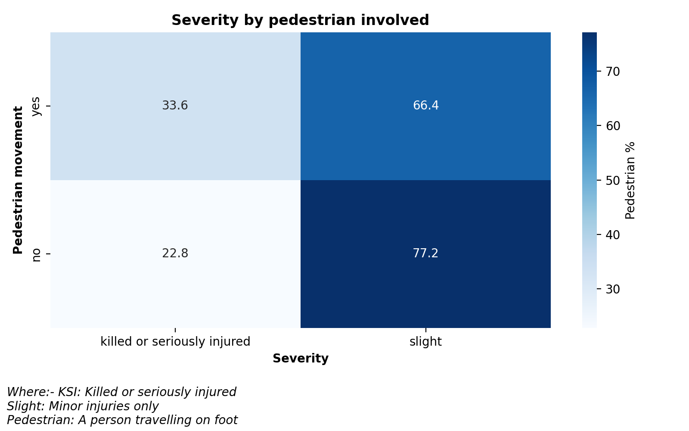
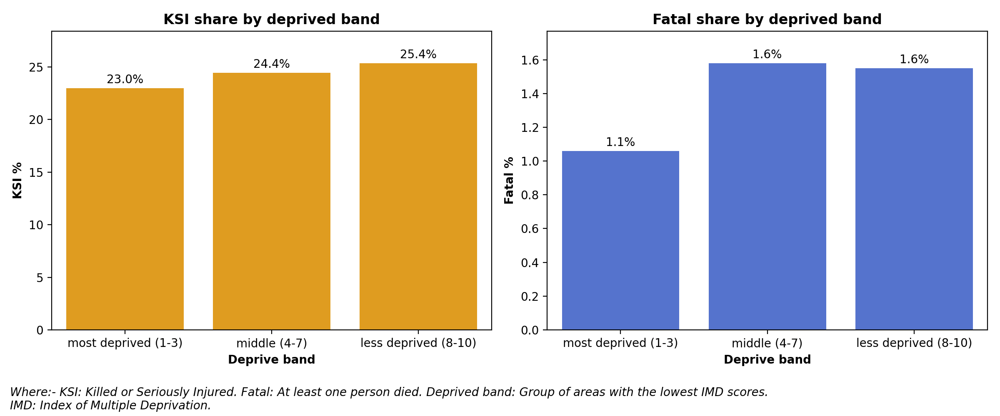

# Gravite — UK Road Accident Severity Prediction

[](https://uk-road-accident-severity-prediction-kvagwdjbzfetxjurws6bcz.streamlit.app)
[](https://www.python.org/)
[](https://scikit-learn.org/)
[](https://plotly.com/)

> **Live link → [uk-road-accident-severity-prediction-kvagwdjbzfetxjurws6bcz.streamlit.app](https://uk-road-accident-severity-prediction-kvagwdjbzfetxjurws6bcz.streamlit.app)**

**Gravite** (from French *gravité* — gravity — and Latin *gravitas*, the weight of things) is a machine-learning web app that predicts whether a road accident is likely to be **KSI — Killed or Seriously Injured** — using only the conditions known *before* the crash happens.

---

## 📌 Overview

| | |
|---|---|
| **Problem** | Road accidents are classified as *slight*, *serious*, or *fatal*. Which pre-crash conditions make a KSI outcome more likely? |
| **Approach** | Clean + merge three open-data tables → explore → train a **balanced Random Forest** for **binary KSI classification** |
| **App** | Streamlit app with an interactive accident form, live probability + decision at threshold **0.45**, full EDA gallery, and a model-detail walkthrough |
| **Design rule** | **No imputation** — missing values stay `NaN` (tree models handle them natively). **No time features** — only causal, pre-accident inputs (no `year`, `date`, `time`) to avoid leakage |

---

## 📊 Dataset

Publicly available **UK road-accident open data** in three tables:

| Table | Role |
|---|---|
| **Collisions** | One row per accident — location, road, light, weather, conditions, severity |
| **Casualties** | Per-casualty details, aggregated (e.g. vulnerable / e-scooter casualties) |
| **Vehicles** | Per-vehicle details, aggregated (e.g. vehicle age) |

After cleaning and merging:

- **513,801 accidents** × 21 analysis columns (one row per accident)
- Severity labels: `1 → fatal`, `2 → serious`, `3 → slight`
- Missing codes (`-1`, `9`, …) converted to **`NaN` — never imputed**
- **Target:** binary **KSI** = fatal + serious (24.2%) vs slight (75.8%) — a ~76 / 24 imbalance

---

## 🔍 Exploratory Data Analysis

Key findings from the EDA notebook:

- **Class imbalance:** 75.8% slight · 22.7% serious · 1.5% fatal — accuracy alone is misleading (an "always slight" model already scores 75.8%)
- **Urban vs rural:** rural accidents are far more dangerous — fatal share is **~3.5× higher** on rural roads (2.8% vs 0.8%)
- **Season:** barely matters — slight-accident share stays ~75–76% across all four seasons
- **Time of day:** accident volume peaks around **evening rush hours**; morning hours carry a smaller share
- **Pedestrians:** accidents involving a pedestrian are much more likely to be serious/fatal (KSI share ~34% vs ~23% otherwise)
- **Deprivation (IMD):** KSI share rises slightly with area deprivation — from 23.0% (least deprived) to 25.4% (most deprived)
- **Spatial hotspots:** a **1 km-grid KSI-rate map** (interactive Plotly map inside the app) highlights where serious accidents concentrate

<details>
<summary><b>📊 Chart gallery (click to expand)</b></summary>

| Severity distribution | Urban vs rural |
|---|---|
|  |  |

| Season pattern | Rush hours |
|---|---|
|  |  |

| Pedestrian involvement | IMD deprivation |
|---|---|
|  |  |

</details>

---

## 🤖 Model — Balanced Random Forest

**Why Random Forest?** Captures non-linear interactions between road/weather/light conditions, robust to outliers, and handles `NaN` without imputation.

**Why balanced?** With a 76/24 split, a plain forest drifts toward "always slight". `class_weight='balanced'` forces attention to the KSI class — so **recall matters more than raw accuracy** in a safety problem: missing a dangerous accident costs more than a false alarm.

| Setting | Value |
|---|---|
| Estimator | `RandomForestClassifier(n_estimators=100, max_depth=15, class_weight='balanced', random_state=42)` |
| Training / test split | 411,040 / 102,761 (stratified 80/20) |
| **Decision threshold** | **0.45** (baked into the deployed model) |

**Performance at threshold 0.45 (positive class = KSI):**

| Metric | Score |
|---|---|
| Precision | **0.338** |
| Recall | **0.740** — catches ~74 of every 100 KSI-prone accidents |
| F1 | **0.464** |
| Majority-class baseline (accuracy) | 0.758 |

> **Feature design:** only pre-accident causal inputs go into `X`. Dropped: `collision_index`, severity/label columns, `did_police_officer_attend_scene_of_accident`, `number_of_casualties`, `max_vehicle_age`, `trunk_road_flag_label`, `special_conditions_at_site_label`, `carriageway_hazards_label`, and all time features (`year`, `date`, `time`).

### Model bundle

The deployed artifact is a single bundle — pipeline + threshold together:

```python
{"model": pipe2, "threshold": 0.45}
```

📦 Download **`model_bundle.pkl`** from the [Releases](https://github.com/YOUR_USERNAME/uk-road-accident-severity-prediction/releases) page (v1.0). The app **downloads it automatically on first run** if it's missing. `scikit-learn` is pinned to **1.6.1** — the version the model was trained with.

---

## 🖥️ The Gravite App

| Page | What it does |
|---|---|
| **Home** | 25-field accident form → live KSI probability with a progress bar and a clear **KSI / not-KSI** decision at threshold 0.45 |
| **EDA** | Six-tab chart gallery + the interactive **1 km-grid KSI hotspot map** |
| **Model detail** | How the forest works, the threshold trade-off, metrics, and feature design |

> ⚠️ *Model predictions may be inaccurate. Educational project — not for operational use.*

---

## 🛠️ Tech stack

- **Python 3.13** (3.11–3.13 recommended — `scikit-learn` wheels unavailable for 3.14 at training time)
- **Streamlit ≥ 1.52** — UI, theming via `.streamlit/config.toml`
- **scikit-learn 1.6.1** — pinned to the training version
- **Plotly** — interactive EDA charts and the hotspot map
- **pandas / numpy / joblib**

```
requirements.txt
├── streamlit>=1.52
├── scikit-learn==1.6.1
├── joblib
├── pandas
├── numpy
└── plotly
```

---

## 🚀 Getting started

```bash
# 1. Clone
git clone https://github.com/YOUR_USERNAME/uk-road-accident-severity-prediction.git
cd uk-road-accident-severity-prediction

# 2. Virtual environment
python -m venv venv
source venv/bin/activate          # Windows: venv\Scripts\activate

# 3. Install dependencies
pip install -r requirements.txt

# 4. Run (model bundle auto-downloads from Releases on first run)
streamlit run gravite/app.py
```

## 📜 License & disclaimer

Educational project. Data: publicly available UK road-accident records; map © OpenStreetMap contributors © CARTO. Predictions are illustrative — **"Model predictions may be inaccurate."**


